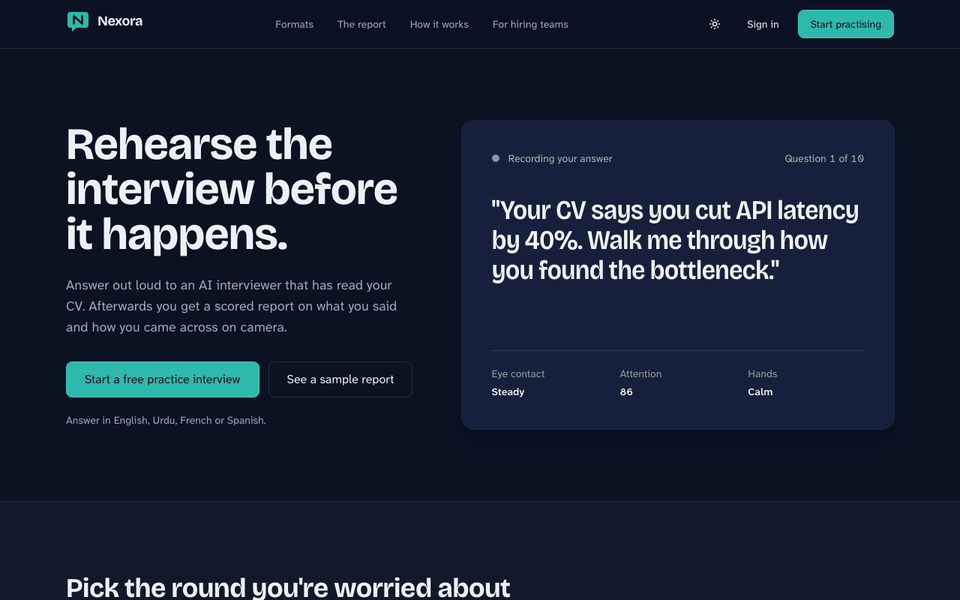
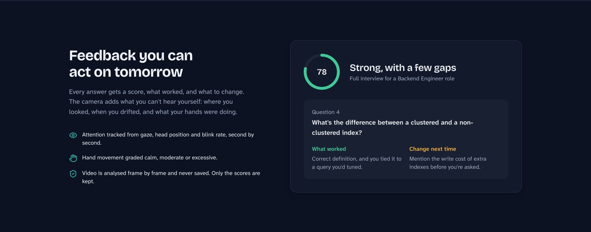
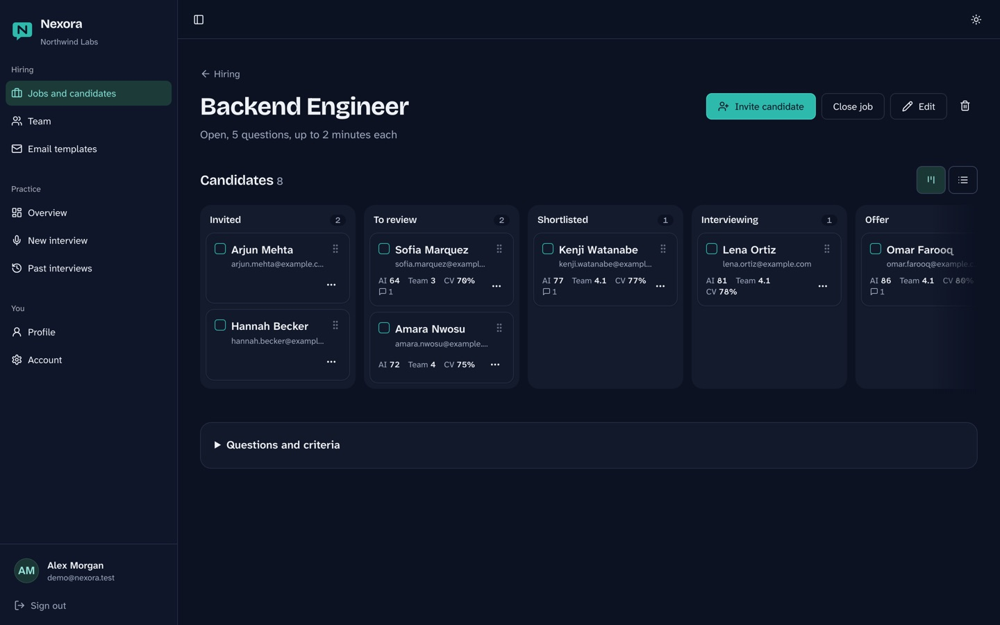
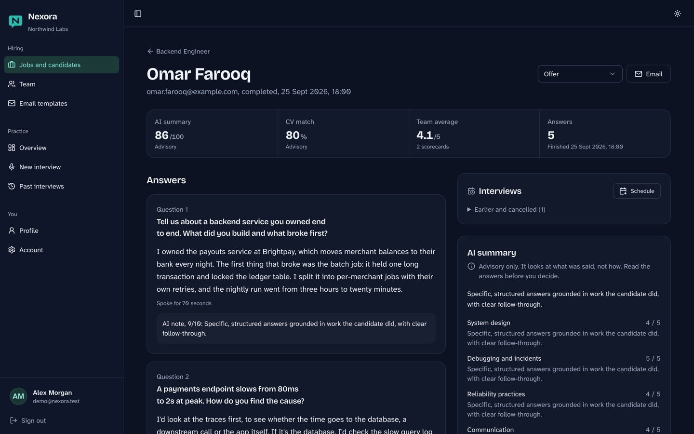
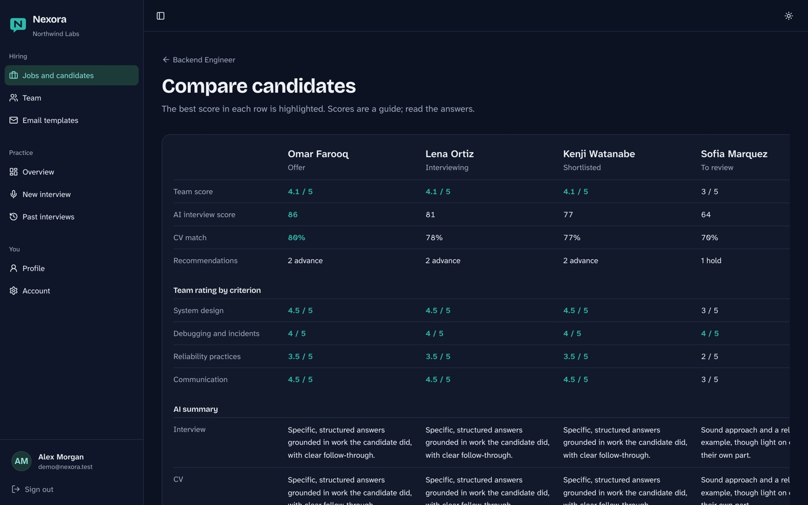

# Umair Hassan

**Software Engineer · Ruby on Rails**

### About

I'm a software engineer in Lahore. I build products with Ruby on Rails, and my favourite part of the job is the stretch where a rough idea turns into something people actually use.

### Journey

<table>
  <tr>
    <td width="150" valign="top"><b>FAST NUCES</b> University</td>
    <td>Studied Computer Science. The project I still think about is a blocks game written in x86 assembly (<a href="https://github.com/Umair0092/Coal-work">Coal-work</a>). When every pixel has to pass through a register, you stop taking anything a computer does for granted.</td>
  </tr>
  <tr>
    <td valign="top"><b>Startup-Pal</b> QbitxSystems</td>
    <td>My first product at QbitxSystems: HR and payroll for startups and small companies. I wrote much of its core (employees, payroll, attendance, leave) and put serious time into the RSpec suite, which cut bugs by up to 80%.</td>
  </tr>
  <tr>
    <td valign="top"><b>Lawzo</b> QbitxSystems</td>
    <td>A legal marketplace where AI helps clients find the right lawyer and book a consultation, in person or over video. I built the AI research agents, the Daily.co video calls, and the live updates and push notifications that hold the flow together.</td>
  </tr>
  <tr>
    <td valign="top"><b>TireTag</b> Now</td>
    <td>A traffic rules enforcement platform we build for a client. I own the technical side: how it's structured, what goes into each release, and what gets merged.</td>
  </tr>
</table>

That work is client code, so it stays private. What's below is what I build for myself.

### Stack

Hotwire (Turbo and Stimulus), RSpec, ActionCable and Solid Queue on the Rails side. React with Tailwind when a page needs more than Hotwire.

### Projects

#### [Nexora](https://github.com/Umair0092/Nexora)

Interview practice you do out loud. An AI interviewer reads your CV and asks questions, and afterwards you get a report on what you said and how you came across on camera. The camera analysis runs in the browser, so the video never leaves your device. Companies can use the same interviewer to screen candidates, with a pipeline board, team scorecards and side-by-side comparison.

Rails 8 · React · TypeScript · PostgreSQL · Groq (LLM and Whisper) · MediaPipe

  

  
<b>See screenshots</b>

   
  <table>
    <tr>
      <td width="50%">
Feedback on each answer
</td>
      <td width="50%">
The hiring pipeline
</td>
    </tr>
    <tr>
      <td width="50%">
Reviewing a candidate
</td>
      <td width="50%">
Comparing candidates
</td>
    </tr>
  </table>

<table>
  <tr>
    <td width="50%" valign="top">
      <h4><a href="https://github.com/Umair0092/embed_sync">embed_sync</a></h4>
      A Ruby gem that keeps vector embeddings in sync with your ActiveRecord models. <a href="https://github.com/ankane/neighbor">neighbor</a> searches vectors and <a href="https://github.com/crmne/ruby_llm">ruby_llm</a> generates them, but keeping them current as records change was still left to you. Early, and built in the open.  
      Ruby · ActiveRecord · pgvector
    </td>
    <td width="50%" valign="top">
      <h4><a href="https://github.com/Umair0092/Bookify">Bookify</a></h4>
      A cross-platform mobile app that puts travel tickets, event passes and local services into one booking flow. One of the detours where I tried other stacks to see how they compare.  
      Flutter · Dart
    </td>
  </tr>
</table>

### Activity

  <picture>
    <source media="(prefers-color-scheme: dark)" srcset="https://raw.githubusercontent.com/Umair0092/Umair0092/output/streak-dark.svg" />
    
  </picture>

<picture>
  <source media="(prefers-color-scheme: dark)" srcset="https://raw.githubusercontent.com/Umair0092/Umair0092/output/github-contribution-grid-snake-dark.svg" />
  
</picture>
